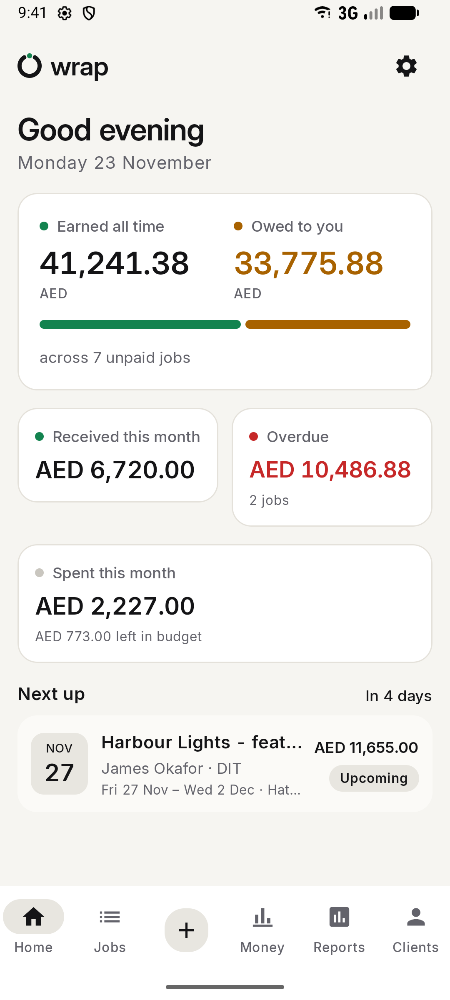
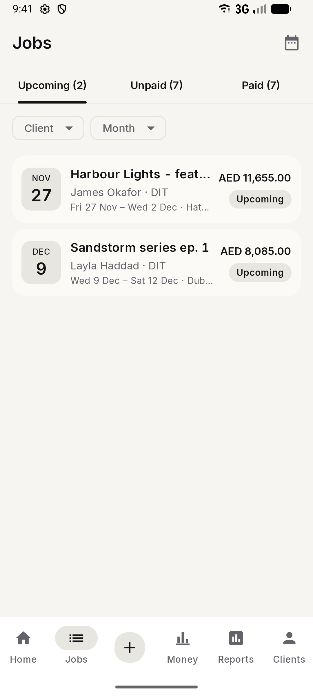
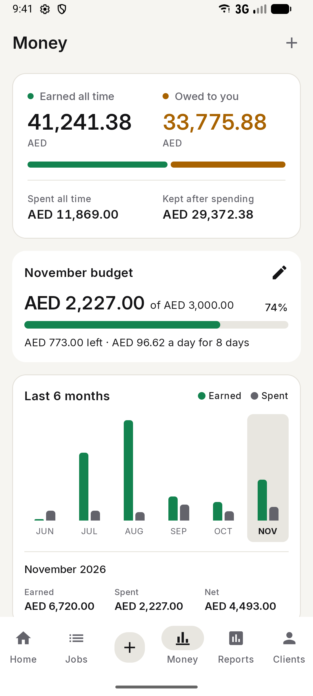
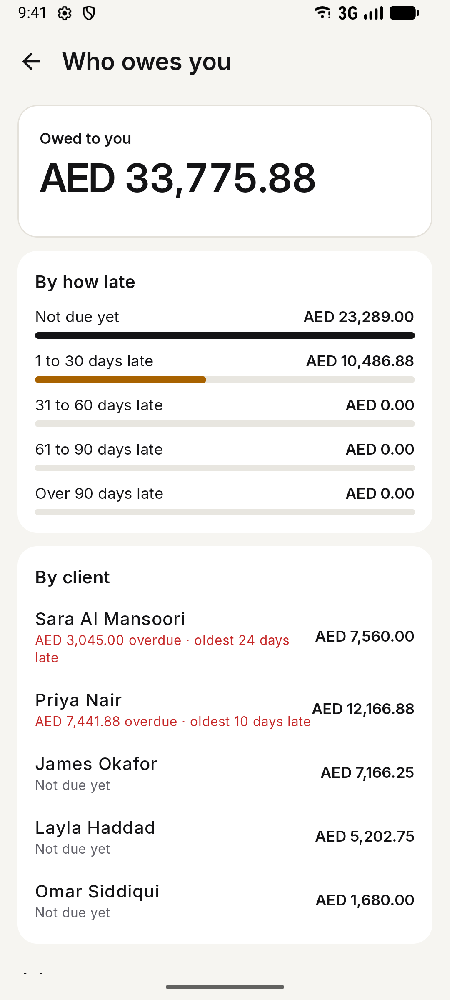
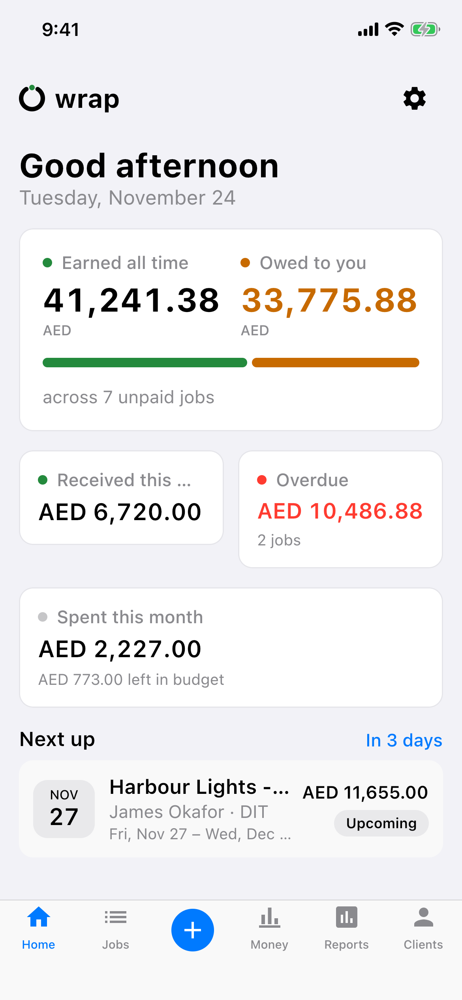
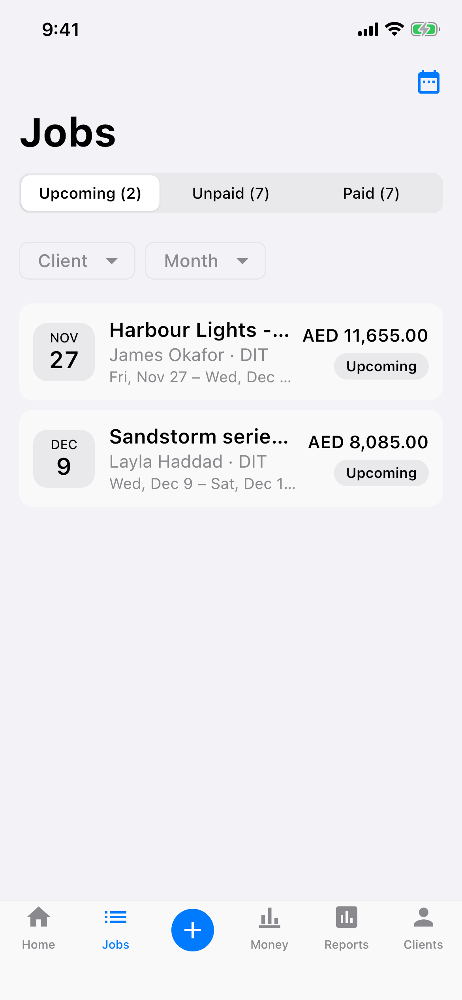
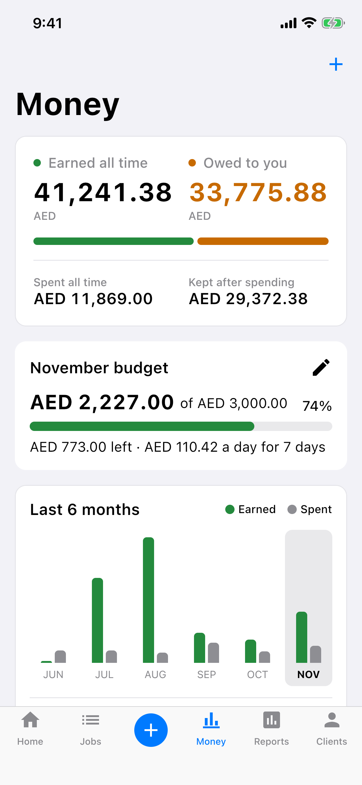
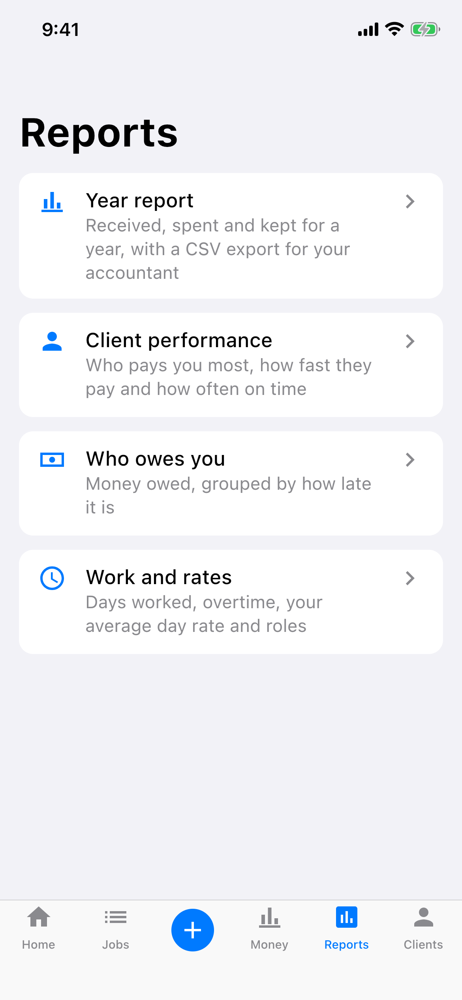
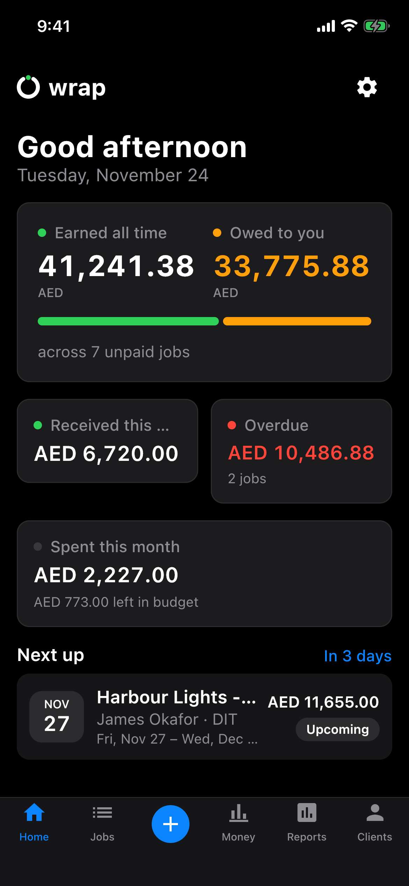

<div align="center">

# 🎬 Wrap

**Jobs, hours and payments for film-set freelancers.**

Track upcoming bookings, clock your hours on set, chase late payments and see what you
actually kept, all offline on your Android phone or iPhone.

[](../../releases/latest)


[Download](#download) · [Screenshots](#screenshots) · [Features](#features) · [Changelog](CHANGELOG.md) · [Build from source](#build-from-source)

</div>

---

## Why Wrap

Freelance crew work day to day for many productions, and the money side gets messy fast:
different rates, overtime, kit rental, invoices, and clients who pay 60 days late. Wrap keeps
all of it in one place, works without an account or internet, and does the maths for you.

## Screenshots

<div align="center">

### Android

| Home | Jobs | Money |
|:---:|:---:|:---:|
|  |  |  |
| **Who owes you** | **Calendar** | **Dark mode** |
|  |  |  |

### iPhone

Same app, made to feel at home on iOS: tab bar, large titles, iOS switches and Apple's own font.

| Home | Jobs | Money |
|:---:|:---:|:---:|
|  |  |  |
| **Reports** | **Dark mode** | |
|  |  | |

<sub>Screenshots use made-up demo data.</sub>

</div>

## Platforms

| Platform | Status |
|----------|--------|
| 🤖 Android 8.0+ | ✅ Available ([download](../../releases/latest)) |
| 🍎 iOS 16+ | ✅ Available ([download the .ipa](../../releases/latest)). Receipt photos, PDF invoices, backups, calendar sync, app lock and reminders are Android-only for now. |

## Download

Everything is on the [**latest release**](../../releases/latest) page.

**Android:** download `Wrap-vX.Y.Z.apk`, open it on your phone and allow installing from your
browser or file manager when asked. Installing a newer version over an older one keeps all
your data.

**iPhone:** Wrap isn't on the App Store yet, so you install the `.ipa` yourself from a Windows
PC or Mac with a free Apple ID:

1. Install [iTunes from apple.com](https://www.apple.com/itunes/) (on Windows, not the
   Microsoft Store version) and [Sideloadly](https://sideloadly.io/).
2. Plug in the iPhone, unlock it and tap **Trust**.
3. Drag `Wrap-vX.Y.Z.ipa` into Sideloadly, enter your Apple ID and press **Start**.
4. On the iPhone, turn on Settings > Privacy & Security > **Developer Mode**, then trust your
   Apple ID in Settings > General > VPN & Device Management.

With a free Apple ID the app has to be re-installed every 7 days (your data stays).

## Features

- **Home**: what you're owed, received this month, overdue jobs, today's job with
  Clock in / Clock out, and your next booking.
- **Jobs**: Upcoming / Unpaid / Paid tabs, filter by client and month, overdue in red.
- **Job detail**: full money breakdown (base, overtime, kit, expenses, billed spending, VAT,
  paid, owed), time logs, payment history, Add payment, and **Chase** (opens WhatsApp with a
  polite reminder of the amount owed; each chase is logged).
- **Call sheet**: unit base and parking (address or pasted maps link) with Directions, crew
  contacts with call and WhatsApp buttons, and a reminder before call time on each job day
  (how long before is set in Settings).
- **Invoices**: an A4 PDF from any job, shared through WhatsApp, email or Drive. Your name,
  bank details, TRN and invoice numbering live in Settings > Your details. A job keeps its
  invoice number. Jobs can add 5% VAT (on by default when you're VAT registered).
- **Chase reminders**: each morning, overdue jobs (3+ days past due) that haven't been chased
  or reminded about for a week get a notification.
- **Calendar**: month view of bookings with double-booked and free days; optionally copies
  every job into the phone's calendar and keeps it up to date.
- **Money**: earned all time (payments received), spent and kept after spending, a
  6-month earned vs spent chart, spending by category (this month / year / all time) and a
  spending log for fuel, kit, food, permits and other work costs. Spending can have a receipt
  photo, be **billed to a job** (added to what the client owes) and **repeat monthly** (phone,
  software, visa; missed months are filled in).
- **Reports** (its own tab): a **year report** (received, spent, kept, VAT, income by client,
  spending by category, month by month, CSV export for an accountant); **client performance**
  (income share, days worked, rates, how many days each client takes to pay and how often on
  time, with a page per client); **who owes you**
  (owed money grouped as not due, 1-30, 31-60, 61-90 and 90+ days late, per client and job);
  and **work and rates** (days, hours, overtime, average day rate, earnings per day, by role,
  last 12 months).
- **Tutorial**: a swipe-through tour on first launch, reopened from Settings > How to use Wrap.
- **Monthly budget**: progress bar with what's left per day for the rest of the month, warning
  colours on Money and Home, and a notification the first time spending reaches 80% and again
  when it goes over (toggle in Settings).
- **Clients** with total owed each; **Settings** (gear on Home) for default rate, day length,
  overtime multiplier, payment terms, currency and reminders.
- **Reminders** at 8 PM the night before each job (WorkManager).
- **Home-screen widget**: owed total, today's or the next job, and Clock in / Clock out.
- **App lock** with fingerprint, face or screen lock (asks again after 30 s in the background).
- **Backup and restore**: a .zip with all data (`wrap.json`) and receipt photos, saved wherever
  you choose (Google Drive, Downloads...). Restoring replaces everything, in one transaction.
  Android's own app backup to Google also covers the database.

## How the money works

The rules live in `shared/` and are unit tested.

| Rate type | Base pay |
|-----------|----------|
| Day       | rate × days |
| Half day  | rate ÷ 2 × days |
| Hourly    | logged hours × rate (planned day length until time is logged) |
| Fixed     | rate |

Overtime (day rate only) = hours beyond the day length on each day × (rate ÷ day length) ×
OT multiplier. Subtotal = base + overtime + kit rental + expenses + spending billed to the
job; total = subtotal + VAT at the job's rate; owed = total − payments.
Status moves UPCOMING → DONE_UNPAID → PART_PAID → PAID automatically; OVERDUE is shown
when money is owed after the due date (end date + payment terms by default).

"Earned" means money actually received. Spending is your own cost of working and is separate
from a job's *expenses*, which are billed to the client.

### Database upgrades

Schema changes ship as SQLDelight migrations (`shared/src/commonMain/sqldelight/migrations/`),
so installing a new build over an old one keeps all data. `MigrationTest` checks each upgrade.

## Project layout

| Module        | What lives there                                                                 |
|---------------|----------------------------------------------------------------------------------|
| `shared/`     | Kotlin Multiplatform (`commonMain`): models, database, money rules, repositories. All business logic. |
| `sharedUi/`   | Compose Multiplatform screens for both phones. Adaptive building blocks give Android Material 3 and iOS its own tab bar, navigation bars, switches and system font. Never calculates money. |
| `androidApp/` | Android shell: activity, widget, notifications, PDF invoices, backups, receipts. |
| `iosApp/`     | iOS shell: a SwiftUI app hosting the shared screens. Project generated with XcodeGen. |

iOS code compiles on any machine; linking the iPhone app needs macOS, so
[CI](.github/workflows/ci.yml) builds it on a GitHub Mac, runs it in the iPhone simulator,
takes screenshots and produces an unsigned `.ipa`.

## Build from source

### Requirements

- JDK 17 or newer (built and tested with JDK 25). `JAVA_HOME` must point at it.
- Android SDK with platform 37 installed.
- `local.properties` in the project root (not committed):

  ```properties
  sdk.dir=C:/Users/<you>/AppData/Local/Android/Sdk
  ```

- `adb` on `PATH` (`<sdk>\platform-tools`) for install / logcat.

### Commands (PowerShell)

```powershell
# Build
.\gradlew.bat assembleDebug

# Install and launch on a running device / emulator
.\gradlew.bat installDebug
adb shell am start -n com.abaan.wrap/.MainActivity

# Tests
.\gradlew.bat :shared:allTests
.\gradlew.bat test

# Watch for crashes (Compose previews don't work in VS Code; verify on device)
adb logcat AndroidRuntime:E com.abaan.wrap:V *:S

# Start the emulator
& "$env:LOCALAPPDATA\Android\Sdk\emulator\emulator.exe" -avd Medium_Phone
```

### VS Code

`.vscode/tasks.json` provides **Build**, **Install & Run**, **Test** and **Logcat (crashes)**
(`Ctrl+Shift+P` → *Tasks: Run Task*). `Ctrl+Shift+B` runs Build.

## Roadmap

- [x] Android app
- [x] Reports, invoices, backups and app lock
- [x] iOS app
- [ ] Receipts, invoices, backups and reminders on iOS
- [ ] App Store release
- [ ] Play Store release

See the [changelog](CHANGELOG.md) for what changed in each version.

## License

Copyright © 2026 Abaan Arakkal. All rights reserved. The source is public to read, but may
not be copied or reused without permission. See [LICENSE](LICENSE).

<div align="center"><sub>Made with kasthapad by Abaan (;</sub></div>
