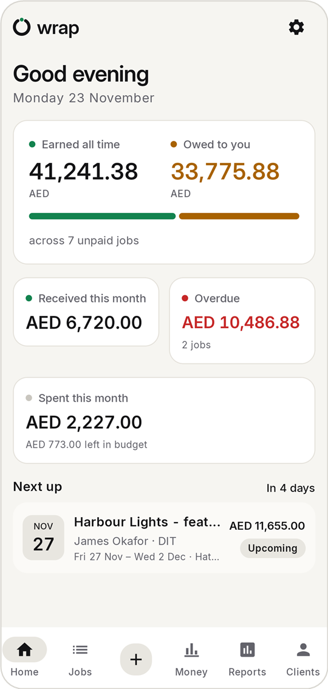
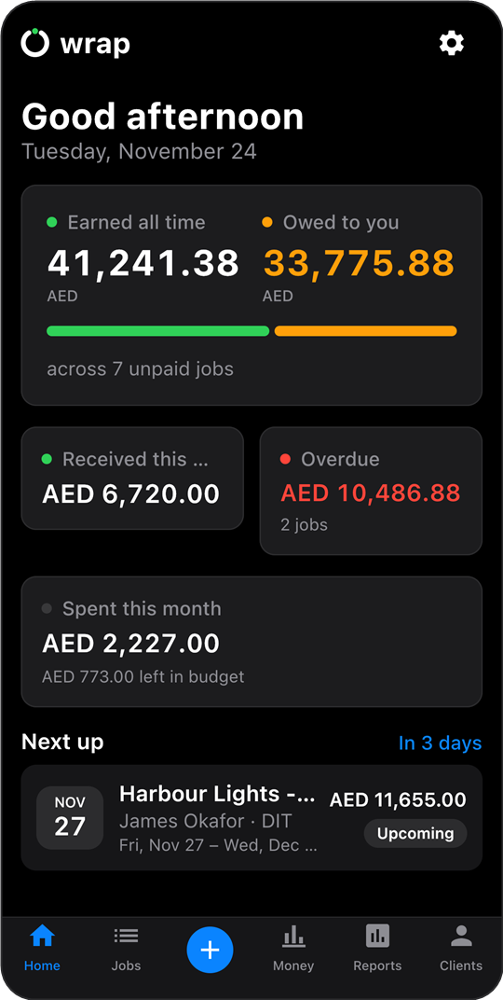

<div align="center">

<picture>
  <source media="(prefers-color-scheme: dark)" srcset="docs/brand/wrap-logo-dark.svg">
  
</picture>

**Jobs, hours and payments for film-set freelancers.**<br>
Bookings, hours on set, late payments and what you actually kept, offline on your phone.

[](../../releases/latest)


**[Download](#download)** · [Features](#features) · [Changelog](CHANGELOG.md) · [License](#license)

<br>


&nbsp;&nbsp;&nbsp;


<sub>Android (left) and iPhone (right). Made-up demo data.</sub>

</div>

> [!IMPORTANT]
> **Wrap is not open source.** The code is public to read, but all rights are reserved: you
> may not copy, change, redistribute or reuse it. You **may** download the released apps and
> use them on your own phone. Only the author can change this project, and contributions are
> not accepted. See [License](#license).

## Why Wrap

Freelance crew work day to day for many productions, and the money side gets messy fast:
different rates, overtime, kit rental, invoices, and clients who pay 60 days late. Wrap keeps
all of it in one place, works without an account or internet, and does the maths for you.

## Download

Get both apps from the [**latest release**](../../releases/latest).

> [!WARNING]
> Only download Wrap from this repository's **Releases** page. Wrap is not on the Play Store or
> App Store, so a copy from anywhere else is not genuine.

### Android 8.0+

1. Download `Wrap-vX.Y.Z.apk` on your phone and open it.
2. Allow installing from your browser or file manager when Android asks.

Installing a newer version over an older one keeps all your data. Don't uninstall first.

### iPhone (iOS 16+)

Wrap isn't on the App Store yet, so you install it yourself from a Windows PC or Mac with a
free Apple ID:

1. Install [iTunes from apple.com](https://www.apple.com/itunes/) (on Windows, **not** the
   Microsoft Store version) and [Sideloadly](https://sideloadly.io/).
2. Plug in the iPhone with a data cable, unlock it and tap **Trust**.
3. Drag `Wrap-vX.Y.Z.ipa` into Sideloadly, enter your Apple ID and press **Start**.
4. On the iPhone, turn on Settings › Privacy & Security › **Developer Mode**, then trust your
   Apple ID in Settings › General › VPN & Device Management.

> [!WARNING]
> With a free Apple ID, iPhone apps installed this way **stop opening after 7 days**. Install
> the same `.ipa` again with Sideloadly to refresh it. Your data stays.

> [!NOTE]
> On iPhone, receipt photos, PDF invoices, backups, calendar sync, app lock and reminders are
> not available yet. They are coming in a later version.

> [!CAUTION]
> Wrap keeps everything **only on your phone**: no account, no cloud. If you delete the app or
> lose the phone, your data is gone. On Android, use Settings › **Back up now** regularly and
> keep the file somewhere safe (Google Drive, your PC). iPhone backups are not available yet.

## Features

- **Home**: what you're owed, received this month, overdue jobs, today's job with Clock in /
  Clock out, and your next booking.
- **Jobs**: upcoming, unpaid and paid jobs, filtered by client and month, with a calendar of
  bookings, clashes and free days.
- **Job detail**: the full money breakdown (base, overtime, kit, expenses, VAT, paid, owed),
  time logs, payments, a call sheet with crew contacts and directions, and **Chase**, which
  sends a polite WhatsApp reminder of what's owed.
- **Money**: earned, spent and kept, a 6-month chart, a monthly budget, and spending that can
  repeat monthly or be billed to a job.
- **Reports**: year report with CSV export for your accountant, client performance, who owes
  you (grouped by how late), and work and rates.
- **Android extras**: PDF invoices, receipt photos, reminders before call time and for late
  payments, home-screen widget, app lock, phone-calendar sync, and backup and restore.

<details>
<summary><b>How the money works</b></summary>

<br>

The rules live in `shared/` and are unit tested.

| Rate type | Base pay |
|-----------|----------|
| Day       | rate × days |
| Half day  | rate ÷ 2 × days |
| Hourly    | logged hours × rate (planned day length until time is logged) |
| Fixed     | rate |

Overtime (day rate only) = hours beyond the day length on each day × (rate ÷ day length) ×
OT multiplier. Subtotal = base + overtime + kit rental + expenses + spending billed to the
job; total = subtotal + VAT at the job's rate; owed = total − payments.
Status moves UPCOMING → DONE_UNPAID → PART_PAID → PAID automatically; OVERDUE is shown
when money is owed after the due date (end date + payment terms by default).

"Earned" means money actually received. Spending is your own cost of working and is separate
from a job's *expenses*, which are billed to the client.

</details>

<details>
<summary><b>Project notes (for the author)</b></summary>

<br>

| Module        | What lives there |
|---------------|------------------|
| `shared/`     | Kotlin Multiplatform: models, database, money rules, repositories. All business logic. |
| `sharedUi/`   | Compose Multiplatform screens for both phones: Material 3 on Android, iOS-style controls on iPhone. |
| `androidApp/` | Android shell: activity, widget, notifications, PDF invoices, backups, receipts. |
| `iosApp/`     | iOS shell: a SwiftUI app hosting the shared screens (XcodeGen project). |

Schema changes ship as SQLDelight migrations, so installing a new build over an old one keeps
all data. iOS code compiles on any machine; the iPhone app is linked on a GitHub Mac by
[CI](.github/workflows/ci.yml), which also runs it in the simulator, takes screenshots and
builds an unsigned `.ipa`.

```powershell
.\gradlew.bat assembleDebug          # Android APK
.\gradlew.bat :shared:allTests test  # tests
.\gradlew.bat :sharedUi:compileKotlinIosSimulatorArm64  # check iOS code compiles
```

Needs JDK 17+ (`JAVA_HOME`), the Android SDK (platform 37) and `local.properties` with `sdk.dir`.

</details>

## Roadmap

- [x] Android app
- [x] iPhone app
- [ ] Receipts, invoices, backups and reminders on iPhone
- [ ] App Store and Play Store

See the [changelog](CHANGELOG.md) for what changed in each version.

## License

Copyright © 2026 Abaan Arakkal. **All rights reserved.**

The source code is published for viewing only. You may download the released apps and use them
for yourself. You may not copy, modify, redistribute or reuse the code or any part of it
without written permission. See [LICENSE](LICENSE).

<div align="center"><sub>Made with kasthapad by Abaan (;</sub></div>
